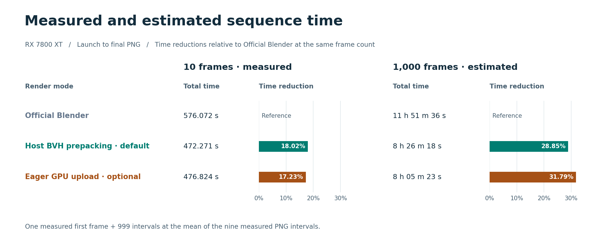
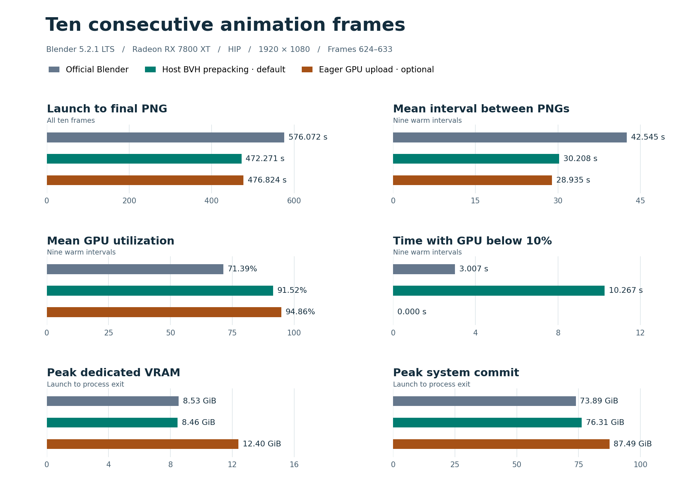

# Cycles Frame Pipeline

English · [简体中文](README.zh-CN.md)

Cycles Frame Pipeline 0.5.0 uses **Host BVH Prepacking** by default. On supported software BVH2 scenes, Blender evaluates frame **N+1** while the GPU samples frame **N**. Cycles validates the next frame’s geometry inputs, packs its BVH on the CPU and keeps the result in system memory. At handoff, the same Cycles session uploads the prepared data and starts sampling. A CPU worker processes the previous frame and writes its PNG.

The Windows engine includes AMD HIP, NVIDIA CUDA and NVIDIA OptiX. The published Host BVH Prepacking benchmark uses an RX 7800 XT with HIP. [GPU and Blender compatibility](#gpu-and-blender-compatibility) · [Ruins benchmark](benchmarks/README.md)

<!-- benchmark-projection:begin -->

**Measured on a Radeon RX 7800 XT.** From launch to the final PNG for Ruins frames 624–633, the default Host BVH Prepacking mode saved **103.801 s (18.02%)** against official Blender. Optional Eager GPU Upload saved **99.248 s (17.23%)**.

| Mode | 10 frames measured | Reduction vs official | 1,000 frames projected | Reduction vs official |
|---|---:|---:|---:|---:|
| Official Blender | 576.072 s | Baseline | 11 h 51 min 36 s | Baseline |
| **Host BVH Prepacking (default)** | **472.271 s** | **18.02%** | **8 h 26 min 18 s** | **28.85%** |
| Eager GPU Upload (optional) | 476.824 s | 17.23% | 8 h 05 min 23 s | 31.79% |



The projection counts launch to the first PNG once, then applies each run’s mean of the next nine PNG intervals to the remaining 999 frames.

<!-- benchmark-projection:end -->

[Install](#install) · [Render an animation](#render-an-animation) · [Benchmark results](#benchmark-results) · [Build and test](#build-and-test)

## When to use it

- **Workload.** Use this mode for consecutive Cycles frames with a gap between GPU sampling windows. It is most effective when BVH work fits inside the preceding frame’s sampling time. Allow system memory for the next packed tree. The GPU holds one active scene, and the first frame pays for loading and initialization.
- **Scene and output.** Use a single enabled view layer, a single view, the Combined pass, PNG output and CPU Open Image Denoise enabled for final rendering on both scene and layer. A compositor using Combined image/alpha can be replayed when its dependencies are supported. Multiple views, active sequencer strips, animated compositor graphs, partial render borders and custom view curves are examples that require the serial path. Automatic mode can fall back to serial output. Use `--fallback error` to require the requested pipeline. [Scene compatibility checks](pipeline/composition.py)

## GPU and Blender compatibility

The engine overlay requires the official **Blender 5.2.1 LTS for Windows x64**, build `9e2066aef7ef`. The installer uses its runtime and GPU kernels. Other Blender versions (including other 5.2.x builds), Linux and macOS require a matching engine port and separate testing.

| Backend | Tested on hardware | Theoretical coverage on Windows x64 |
|---|---|---|
| AMD HIP | Radeon RX 7800 XT, software BVH2 | RDNA 1 and newer. Examples include Radeon RX 5000, 6000, 7000 and 9000. Blender lists Radeon Software 24.9.1 or Radeon PRO Software 24.Q4 as its Windows minimum. |
| NVIDIA CUDA | RTX 3090 rendering verified in v0.4.0. The software BVH2 path supports host prepacking in 0.5.0 by design. | Compute capability 5.0 or higher with a compatible Blender CUDA kernel and driver. |
| NVIDIA OptiX | RTX 3090 rendering verified in v0.4.0. OptiX builds its own acceleration structures. | Compute capability 5.0 or higher, NVIDIA driver 575 or newer. RTX GPUs can use their RT cores for ray tracing. |

The theoretical range follows the requirements for the pinned Blender 5.2 runtime. The Windows package includes single-GPU HIP, CUDA and OptiX. The published measurements apply to the AMD configuration below. [Blender 5.2 GPU requirements](https://docs.blender.org/manual/en/5.2/render/cycles/gpu_rendering.html) · [NVIDIA compute capability by model](https://developer.nvidia.com/cuda/gpus)

HIP and CUDA use native software BVH2 validation and packing when the scene qualifies. OptiX uses its native device build at handoff with the default upload policy. The optional eager upload policy prepares the next device scene in a second session and requires more VRAM.

## Install

1. Install the official **Blender 5.2.1 LTS Windows x64** build. The installer checks the build hash because the patched executable uses the matching Blender runtime and HIP, CUDA and OptiX kernels.
2. For the English interface, download `cycles-frame-pipeline-windows-x64-0.5.0-en.zip` (Windows engine overlay and English installer) and `cycles_frame_pipeline-0.5.0-en.zip` (extension) from the [latest release](https://github.com/UnitTurn/cycles-frame-pipeline/releases/latest). The Chinese distribution has the same extension ID and engine. Install one language edition. Extract the engine overlay to `.\downloads\engine` for the paths below. From your working directory, run the included English installer in PowerShell. Adjust the official installation path and choose a new destination directory for the side-by-side runtime.

   ```powershell
   .\downloads\engine\install_backend.ps1 `
       -PatchedExe '.\downloads\engine\blender.exe' `
       -BlenderInstall 'C:\Program Files\Blender Foundation\Blender 5.2' `
       -Destination '.\backend'
   ```

3. Open the English Blender window using the launcher installed with the backend.

   ```powershell
   .\backend\open_blender.ps1
   ```

4. **In that window**, open **Edit → Preferences → Get Extensions → menu → Install from Disk**, select `cycles_frame_pipeline-0.5.0-en.zip` and choose the default user repository. Enable **Cycles Frame Pipeline**. Use the same launcher next time. It keeps this edition's preferences and default extensions under `%LOCALAPPDATA%\CyclesFramePipeline\5.2\en_US`. On first launch, it imports the existing startup settings and default user extensions.

**Using your regular Blender profile.** Starting `backend\blender.exe` directly follows your normal Blender language and preferences. To submit from an official Blender installation, install the English extension in that window and set **Custom Blender Executable** to the patched `backend\blender.exe`. The CLI workflow below uses the repository scripts and the backend.


## Render an animation

**Select your GPU.** In the Blender profile used for rendering, open **Edit → Preferences → System → Cycles Render Devices**, choose **HIP**, **CUDA** or **OptiX**, enable the target GPU only and save preferences. In the source scene set **Render Properties → Cycles → Device** to **GPU Compute**. Select **OpenImageDenoise** for final rendering and disable **Use GPU** for that denoise. Save the scene before submitting it from disk.

**Blender UI.** In **Render Properties → Cycles Frame Pipeline**, select the current scene or a saved `.blend`, choose **Use Scene Settings** and a PNG output directory, then click **Start Pipeline Render**. New configurations default to **Host BVH Prepacking**. Set the scene frame range to 1–1000 and step to 1 for the example. For large scenes, submit the saved file from an empty Blender window.

**Command line.** From the repository root, replace `.\scene.blend` with your scene. This example uses the scene's saved render settings and writes `0001.png` through `1000.png`. The background process reads the device preferences for the Blender profile it starts with.

```powershell
& .\backend\blender.exe -b '.\scene.blend' --python-exit-code 9 -P .\pipeline\render.py -- `
    --output '.\renders' --start 1 --end 1000 --step 1 `
    --post-threads 6
```

| Option | Use |
|---|---|
| `--host-bvh-prepacking` | Explicitly select the default native preparation mode. `--defer-upload` is an alias. |
| `--eager-upload` | Prepare and upload the next frame in a second Cycles session while the current frame is sampling. |
| `--profile scene` / `ruins-hip256` | Use saved scene settings for HIP, CUDA or OptiX. The optional Ruins preset explicitly selects the RX 7800 XT on HIP, up to 256 samples and a 0.01 adaptive threshold. |
| `--existing error` / `skip` / `replace` | Stop at an existing PNG (default), skip it, or overwrite it. |

Early packing requires a single background render tile. Per-batch pixel jitter, textures with on-demand tile loading, and geometry that needs GPU displacement use the corresponding native update at handoff. The log records `host_bvh_ready` when the packed data is ready in system memory and `bvh_pack_consumed` when the next frame consumes it. OptiX uses its backend-specific acceleration structures.

<!-- benchmark-measurements:begin -->

<a id="benchmark-and-image-quality"></a>

## Benchmark results

All three runs rendered Ruins frames 624–633 in order on one Radeon RX 7800 XT at 1920 × 1080, using HIP, persistent data and up to 256 adaptive samples at a 0.01 threshold.

| Measurement | Official Blender | Host BVH Prepacking (default) | Eager GPU Upload (optional) |
|---|---:|---:|---:|
| Launch to first PNG | 193.164 s | 200.398 s | 216.408 s |
| Launch to final PNG | 576.072 s | **472.271 s** | 476.824 s |
| Mean interval between PNGs | 42.545 s | 30.208 s | 28.935 s |
| Mean GPU utilization between first and final PNG | 71.39% | 91.52% | 94.86% |
| Time below 10% GPU utilization in that window | 3.007 s | 10.267 s | 0.000 s |
| Peak dedicated VRAM | 8.53 GiB | 8.46 GiB | 12.40 GiB |
| Peak physical RAM in use | 31.95 GiB | 31.95 GiB | 31.95 GiB |
| Peak system commit | 73.89 GiB | 76.31 GiB | 87.49 GiB |



The default mode finished packing the next frame’s BVH during the preceding frame’s sampling window at all nine handoffs. The median gap between adjacent GPU sampling windows was **1.472 s**. Eager GPU Upload used a second session and its median gap was **0.147 s**. The full report includes the three telemetry traces, per-frame timings and test conditions. [Measurements and method](benchmarks/README.md)

### Historical image comparison · v0.4.0 Eager GPU Upload vs official Blender

The pixel comparison decodes each prepared PNG and compares it with the official PNG for the same frame. Of 20,736,000 pixels, **5,343** differed in RGB, with a maximum absolute difference of **1/255** in every frame. All alpha values matched. The mean absolute difference over RGB channels was **0.00008644** on the 0–255 scale. [Historical benchmark](https://github.com/UnitTurn/cycles-frame-pipeline/blob/v0.4.0/benchmarks/README.md)

<!-- benchmark-measurements:end -->

**NVIDIA CUDA and OptiX.** Earlier RTX 3090 tests completed a three-frame animation on both backends. The benchmark for the new default uses the RX 7800 XT.

## Build and test

To build the backend from source, use Python 3.11+, Git with Git LFS, CMake, Ninja, LLVM **20.1.0** (`clang-cl`), x64 MSVC **14.44** headers/libraries/redistributables, Windows SDK **10.0.26100.0** and the matching official Blender installation. The script fetches the pinned Blender source and Windows dependencies, applies the patch series and copies the matching official HIP, CUDA and OptiX kernels into the build. For the OptiX host backend it fetches the pinned NVIDIA OptiX 8.0.0 headers. To use an existing SDK, pass `-OptixDir <SDK root>`. In a Visual Studio Developer PowerShell with those MSVC tool and redist directories selected, run the following from the repository root. Adjust the LLVM root to your installation.

```powershell
.\engine\build_backend.ps1 -ClangDir 'C:\Program Files\LLVM' `
    -MsvcDir $env:VCToolsInstallDir -RedistDir $env:VCToolsRedistDir -InstallDir .\backend
python tools/package.py
```

The language-specific extension ZIPs and shared source ZIP are written to `dist/`. Without `-InstallDir`, the backend installs to `work/clang-release/`. Once the source and dependencies have been fetched, `-Offline` reuses the local checkouts. [Build script](engine/build_backend.ps1) · [Cycles patch series](engine/patches)

On an RX 7800 XT, the following test generates a small animated scene with a camera-dependent world shader, renders three frames with both engines and compares the decoded RGBA pixels. Use a new output directory.

```powershell
python -m pip install numpy pillow
python engine/lookahead/check_stock_pipeline.py `
    'C:\Program Files\Blender Foundation\Blender 5.2\blender.exe' `
    .\backend\blender.exe .\parity-check --prepared
```

## License

The project is distributed under **GPL-3.0-or-later**. Upstream Blender and Cycles files retain their license notices. [License text](COPYING)
