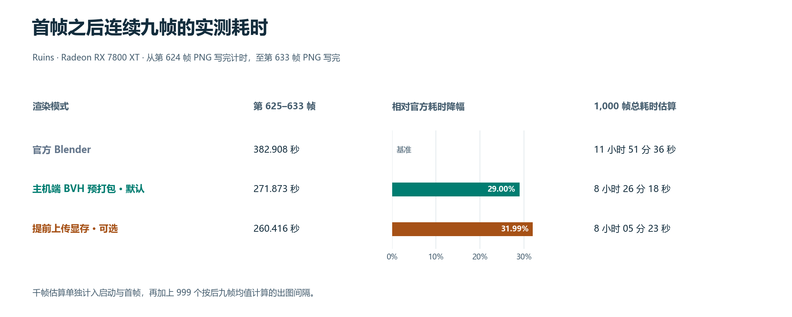
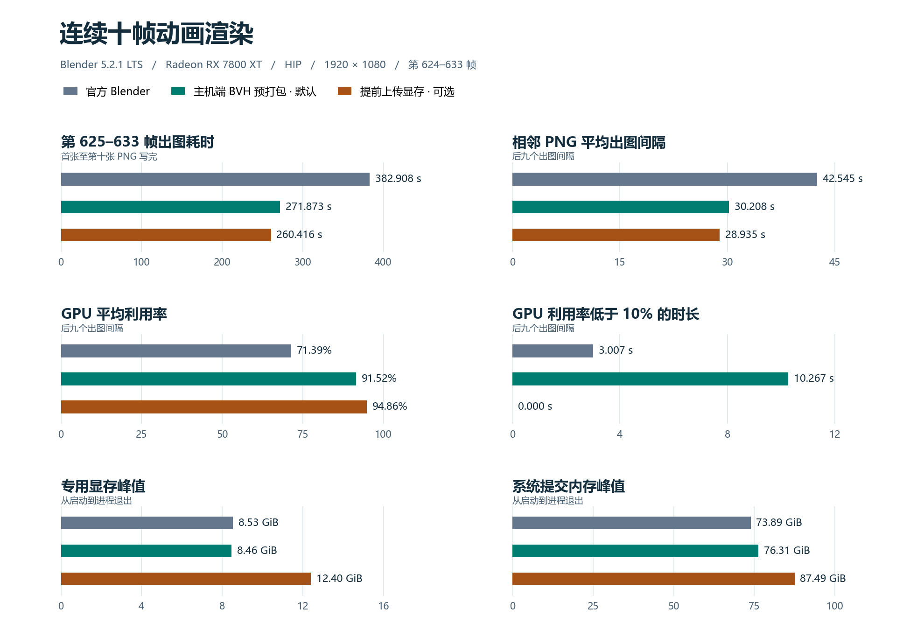

# Cycles 帧间流水线

[English](README.md) · 简体中文

让一张显卡连续渲染 Blender 动画。GPU 采样第 **N** 帧时，Blender 按动画顺序对第 **N+1** 帧做正式场景求值，第二个 Cycles 会话准备该帧的场景数据和加速结构。切帧时直接用准备好的会话采样，省去重复求值。后台 CPU 进程同时为前一帧降噪，并输出编号 PNG。

Windows 发行包提供 AMD HIP 和 NVIDIA CUDA、OptiX。公开的 Ruins 耗时与成片对照来自 RX 7800 XT 的 HIP 实测。两个 NVIDIA 后端均已在 RTX 3090 上完成独立的三帧回归场景。[显卡与 Blender 兼容范围](#显卡与-blender-兼容范围) · [已公开的 Ruins 基准](benchmarks/README.zh-CN.md)

**RX 7800 XT 的 1,000 帧耗时估算。** 如果一段 1080p 动画的出图节拍与 Ruins 第 624–633 帧实测相同，流水线预计节省 **3 小时 29 分 26 秒**。下表统一比较从启动到末张 PNG 写完的耗时，降幅按 `（官方耗时 − 流水线耗时）/ 官方耗时` 计算。

| 帧数与数据来源 | 官方 Blender | 发布版 | 耗时降幅 |
|---|---:|---:|---:|
| 10 帧 · 实测 | 560.25 秒 | 466.03 秒 | **16.82%** |
| 1,000 帧 · 推算 | 11 小时 29 分 41 秒 | 8 小时 00 分 15 秒 | **30.37%** |



估算只计一次启动耗时，用实测的九个出图间隔推算其余帧。`千帧耗时 = 首张 PNG 耗时 + 999 × (第十张 PNG 耗时 − 首张 PNG 耗时) / 9`。以启动为起点，官方的两项原始读数为 189.144 和 560.246 秒，发布版为 208.306 和 466.027 秒。镜头的几何复杂度或采样负担变化时，实际出图间隔也会变化。

[安装](#安装) · [渲染动画](#渲染动画) · [实测与成片对照](#实测与成片对照) · [从源码构建并验证](#从源码构建并验证)

## 适用场景

- **作业类型。** 按顺序渲染 Cycles 动画，前一帧采样结束与下一帧采样开始之间有明显空档。几何、相机、运动模糊和材质均按原帧序求值。两个会话同时持有设备数据，需要额外显存和系统内存。首帧仍要承担加载场景和初始化的耗时。
- **场景与输出。** 启用单个视图层、单视图、Combined 通道和 PNG 输出，在场景和视图层上均开启最终渲染降噪，使用 CPU Open Image Denoise。仅使用 Combined 图像和 alpha、且依赖受支持的合成器可在后台重放。多视图、参与输出的视频序列、带动画的合成节点树、局部渲染边框、自定义色彩曲线等设置需要串行处理。「并行准备下一正式帧」遇到不支持的设置会在提交时报告原因。[兼容条件](pipeline/composition.py)

## 显卡与 Blender 兼容范围

配套引擎使用官方 **Blender 5.2.1 LTS Windows x64**，提交号 `9e2066aef7ef`。安装程序从该版本取得运行库和 GPU 内核。其他 Blender 版本（包括其他 5.2.x 构建）、Linux 和 macOS 均需单独适配和验证引擎。

| 后端 | 项目实机验证 | Windows x64 理论范围 |
|---|---|---|
| AMD HIP | Radeon RX 7800 XT，软件 BVH2 | RDNA 1 及更新架构，例如 Radeon RX 5000、6000、7000 和 9000 系列。Blender 列出的 Windows 最低驱动为 Radeon Software 24.9.1 或 Radeon PRO Software 24.Q4。 |
| NVIDIA CUDA | GeForce RTX 3090，软件 BVH2 | 计算能力 5.0 及以上，驱动能加载对应的 Blender CUDA 内核。例如 GeForce RTX 20、30、40 和 50 系列。 |
| NVIDIA OptiX | GeForce RTX 3090，OptiX 原生加速结构 | 计算能力 5.0 及以上，NVIDIA 驱动 575 或更新。RTX 显卡可用 RT 核心加速光线追踪。 |

理论范围依据 Blender 5.2 的设备要求。官方 5.2.1 Windows 运行包提供预编译 CUDA 内核和备用 PTX，主要 OptiX PTX 内核的编译目标为 `sm_50`。其他型号须能用匹配的官方 Blender 在所选后端完成渲染，并有足够内存容纳两个会话。耗时和像素差数据只对应具体实测卡、后端和场景。本发行包面向单卡作业，未提供 HIP RT、Intel oneAPI 或 Apple Metal 后端。[Blender 5.2 官方 GPU 要求](https://docs.blender.org/manual/zh-hans/5.2/render/cycles/gpu_rendering.html) · [NVIDIA 显卡计算能力查询](https://developer.nvidia.com/cuda/gpus)

HIP 和 CUDA 在复用前一帧的软件 BVH2 时校验输入，输入变化会触发重新构建。OptiX 使用自己的加速结构准备下一帧。三个后端均可提前准备下一帧，并把 CPU 降噪和 PNG 输出安排在后续帧采样期间。路径追踪可选 GPU，最终降噪选择 CPU Open Image Denoise。

## 安装

1. 安装官方 **Blender 5.2.1 LTS Windows x64**。配套程序使用同一版本的 Blender 运行库以及 HIP、CUDA 和 OptiX 内核，安装脚本会检查官方构建的提交号。
2. 从[最新发行版](https://github.com/expitau-one/cycles-frame-pipeline/releases/latest)下载简体中文版的 Windows 引擎覆盖包 `cycles-frame-pipeline-windows-x64-0.4.0-zh-CN.zip`（含中文安装程序）和扩展 `cycles_frame_pipeline-0.4.0-zh-CN.zip`。两种语言的扩展使用相同的扩展 ID 和引擎，选择其中一种安装。按下例将引擎覆盖包解压到 `.\downloads\engine`，从工作目录打开 PowerShell，运行包内的中文安装脚本。按实际情况填写官方 Blender 安装位置，并为配套引擎选择一个尚不存在的目标目录。

   ```powershell
   .\downloads\engine\install_backend.ps1 `
       -PatchedExe '.\downloads\engine\blender.exe' `
       -BlenderInstall 'C:\Program Files\Blender Foundation\Blender 5.2' `
       -Destination '.\backend'
   ```

3. 运行安装到引擎目录的启动脚本，打开简体中文 Blender 窗口。

   ```powershell
   .\backend\open_blender.ps1
   ```

4. **在刚打开的窗口中**进入「编辑 → 偏好设置 → 获取扩展」，打开菜单，选择「从磁盘安装」。选中 `cycles_frame_pipeline-0.4.0-zh-CN.zip`，使用默认用户扩展仓库，启用 **Cycles 帧间流水线**。下次使用同一脚本启动。简体中文版的偏好设置和默认扩展保存在 `%LOCALAPPDATA%\CyclesFramePipeline\5.2\zh_HANS`。首次启动时会继承已有的启动配置和默认用户扩展。

**使用平时的 Blender 配置。** 直接启动 `backend\blender.exe` 时，会沿用原有 Blender 语言与偏好设置。也可以在官方 Blender 窗口中安装简体中文扩展，将「定制 Blender 程序」指向配套的 `backend\blender.exe` 后提交渲染。下文命令行用法需要源码中的脚本和配套引擎。


## 渲染动画

**选择显卡。** 在用于渲染的 Blender 配置中打开「编辑 → 偏好设置 → 系统 → Cycles 渲染设备」，选择 **HIP**、**CUDA** 或 **OptiX**，只勾选目标显卡并保存偏好设置。在源场景的「渲染属性 → Cycles → 设备」中选择「GPU 计算」。最终渲染降噪选择 **OpenImageDenoise**，关闭降噪的「使用 GPU」。从磁盘提交时先保存场景。

**通过 Blender 界面。** 在「渲染属性 → Cycles 帧间流水线」选择当前场景或磁盘上的 `.blend`，选择「使用场景设置」，设置 PNG 输出目录和「Cycles 原生降噪与输出」。勾选「优化原版 BVH（配套引擎）」，在「BVH 输入」中选择「并行准备下一正式帧」，点击「启动流水线渲染」。按照千帧示例，将场景帧范围设为 1–1000、步长设为 1。面板按写完的 PNG 统计进度。大型场景可以从空白 Blender 窗口选择磁盘文件提交。

**通过命令行。** 在项目根目录运行，把 `.\scene.blend` 换成自己的场景。下例使用已保存的渲染设置，输出 `0001.png` 到 `1000.png`。后台进程读取其启动时所用 Blender 配置中的渲染设备偏好。

```powershell
& .\backend\blender.exe -b '.\scene.blend' --python-exit-code 9 -P .\pipeline\render.py -- `
    --output '.\renders' --start 1 --end 1000 --step 1 `
    --profile scene --mode native --bvh-input prepared --post-threads 6
```

| 参数 | 用途 |
|---|---|
| `--bvh-input prepared` | 启用双会话，一边采样当前帧，一边正式准备下一帧。配合 `--mode native` 使用。 |
| `--profile scene` / `ruins-hip256` | HIP、CUDA 和 OptiX 均可沿用场景设置。可选的 Ruins 预设会指定 RX 7800 XT 和 HIP，最多 256 采样，自适应阈值 0.01。 |
| `--existing error` / `skip` / `replace` | 遇到已有 PNG 时退出（默认）、跳过或覆盖。 |

## 实测与成片对照

**AMD HIP。** Ruins 基准按原顺序连续渲染第 624–633 帧，1920×1080、RX 7800 XT、普通 HIP、持久化数据、最多 256 个自适应采样，阈值 0.01，CPU OIDN 六线程。官方 Blender 与流水线各完整渲染一次。



| 指标 | 官方 Blender | 发布版 |
|---|---:|---:|
| 启动到首张 PNG 写完 | 189.14 秒 | 208.31 秒 |
| 启动到末张 PNG 写完 | 560.25 秒 | **466.03 秒** |
| 后九帧平均出图间隔 | 41.23 秒 | **28.64 秒** |
| 首张 PNG 写完后的平均 GPU 利用率 | 69.91% | **94.85%** |
| 首张 PNG 写完后 GPU 利用率低于 10% 的时长 | 81.82 秒 | **3.00 秒** |
| 专用显存峰值 | 8.62 GiB | **12.29 GiB** |
| 系统提交内存峰值 | 73.10 GiB | **85.21 GiB** |

从启动到末张 PNG 写完，流水线比官方 Blender 节省 **94.22 秒（16.82%）**。九次切帧时，下一帧都在当前帧最后一批 GPU 采样结束前准备就绪。相邻两帧采样之间的间隔中位数为 **0.139 秒**。GPU 利用率约每秒采样一次，统计整张卡。系统提交内存可由物理内存或 Windows 页面文件承载，两组实测的物理内存使用峰值均为 31.95 GiB。

**画面对照。** 解码十对 PNG 后，共 20,736,000 个像素，其中 5,343 个像素的 RGB 与官方成片相差 1 个 8 位色阶，其余像素的 RGB 和全部 alpha 完全一致。两个会话交接时会继承同一份环境光重要性采样表，世界材质变化时重新计算。另用正式发行程序渲染四帧动画，在第 3 帧改变世界亮度，四张 RGBA 与官方均逐像素一致。

以上 AMD 数据来自已记录的 HIP 十帧实测。另用本次 Windows 多后端引擎在 RX 7800 XT 上渲染三帧回归场景，RGBA 与官方逐像素相同。Ruins 生产场景为私有素材。仓库提供实测数据、图表重绘脚本和用于验证画面的程序化小场景。[AMD 基准数据、逐秒曲线与测量方法](benchmarks/README.zh-CN.md)

**NVIDIA CUDA 和 OptiX。** 在 RTX 3090 上，两种后端均完成了三帧回归动画，实际运行了下一帧的提前准备和 CPU 帧尾处理，并对照了同后端官方 Blender 的 PNG 像素。在 Ruins 原工程上，官方 CUDA 完成了整段序列，CUDA 并行准备模式输出若干帧后触及 Windows 系统提交内存上限。此类大场景除了要留出显存，还需要足够的物理内存和页面文件容量。上表的公开耗时与吞吐数据适用于 RX 7800 XT。

## 从源码构建并验证

构建需要 Python 3.11+、Git 和 Git LFS、CMake、Ninja、LLVM **20.1.0**（`clang-cl`）、x64 MSVC **14.44** 头文件、库与可再发行组件、Windows SDK **10.0.26100.0**，以及匹配的官方 Blender。脚本会取得固定提交的 Blender 源码和 Windows 依赖，应用补丁，并将官方 HIP、CUDA 和 OptiX 内核复制到配套构建中。构建 OptiX 后端时，脚本会获取固定版本的 NVIDIA OptiX 8.0.0 头文件。如已安装对应 SDK，可传入 `-OptixDir <SDK 根目录>`。在选好对应 MSVC 工具和可再发行组件的 Visual Studio Developer PowerShell 中，从项目根目录执行以下命令。LLVM 路径按本机安装位置填写。

```powershell
.\engine\build_backend.ps1 -ClangDir 'C:\Program Files\LLVM' `
    -MsvcDir $env:VCToolsInstallDir -RedistDir $env:VCToolsRedistDir -InstallDir .\backend
python tools/package.py
```

两个语言版本的插件 ZIP 和公共源码 ZIP 输出到 `dist/`。省略 `-InstallDir` 时，配套引擎默认安装到 `work/clang-release/`。源码与依赖已就绪后，使用 `-Offline` 可复用本地检出目录。[构建脚本](engine/build_backend.ps1) · [Cycles 补丁](engine/patches)

在 RX 7800 XT 上，以下测试会生成一个世界材质读取相机坐标的小型动画场景，分别用官方和配套引擎渲染三帧，比较解码后的 RGBA 像素。请为本次测试指定新的输出目录。

```powershell
python -m pip install numpy pillow
python engine/lookahead/check_stock_pipeline.py `
    'C:\Program Files\Blender Foundation\Blender 5.2\blender.exe' `
    .\backend\blender.exe .\parity-check --prepared
```

## 许可证

项目以 **GPL-3.0-or-later** 发布。上游 Blender 和 Cycles 文件保留各自的许可证声明。[许可证全文](COPYING)
