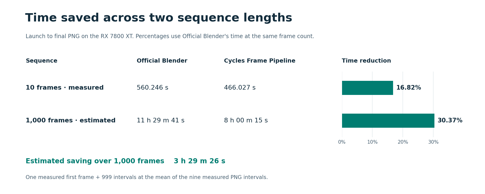
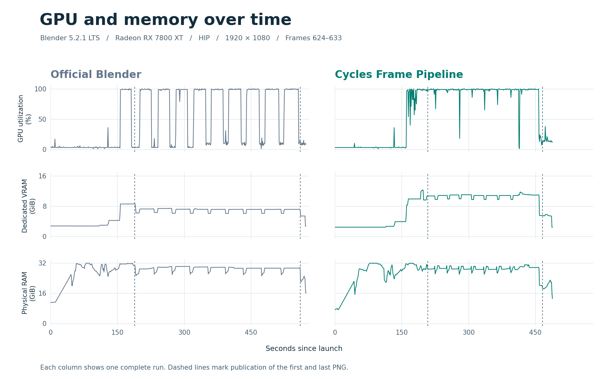

# Animation benchmark

English · [简体中文](README.zh-CN.md)

For a **1,000-frame** animation with the same steady output pace as the measured Ruins sequence, Cycles Frame Pipeline is estimated to save **3 h 29 m 26 s (30.37%)** on a Radeon RX 7800 XT. The ten frames measured on that card saved **94.219 s (16.82%)**.



| Sequence | Official Blender | Cycles Frame Pipeline | Reduction relative to official |
|---|---:|---:|---:|
| 10 frames, measured | 560.246 s | 466.027 s | 16.82% |
| 1,000 frames, estimated | 11 h 29 m 41 s | 8 h 00 m 15 s | 30.37% |

The model counts one launch and one first frame. It adds 999 more PNG intervals at the mean pace of the nine measured intervals. From the millisecond measurements, `T₁₀₀₀ = T₁ + 999 × (T₁₀ − T₁) / 9`. For official Blender, `T₁ = 189.144 s` and `T₁₀ = 560.246 s`, giving **41,381.466 s**. For the release, `T₁ = 208.306 s` and `T₁₀ = 466.027 s`, giving **28,815.337 s**. Percent savings use the official time for the same sequence length as the denominator. The release's longer startup accounts for a smaller share of the 1,000-frame total. Changes in scene complexity or resource pressure across a longer sequence would change its actual time. [Projection inputs and results](data/projection.csv)

## Measured ten-frame run

Cycles rendered frames 624–633 of the Ruins production scene in order. Each configuration ran once. GPU utilization, VRAM, system memory and pixel comparisons below are measurements from those ten frames.


## Test conditions

| Setting | Value |
|---|---|
| Platform | Windows x64, Blender 5.2.1 LTS, upstream revision `9e2066aef7ef` |
| Render | Cycles, HIP, software BVH2, persistent data, hardware RT disabled |
| Hardware | One Radeon RX 7800 XT with 15.96 GiB dedicated memory, 31.95 GiB system RAM |
| Frames | 624–633 in order, 1920 × 1080, 8-bit RGBA PNG |
| Sampling and output | Up to 256 samples, adaptive threshold 0.01, CPU Open Image Denoise. Cycles Frame Pipeline used six threads in the postprocess worker. |

**Official Blender** used the production worker with synchronous frame output. **Cycles Frame Pipeline** used asynchronous native denoising and output. It evaluated the next render frame, validated and packed its BVH, and uploaded its device data while the GPU sampled the current frame. The English and Simplified Chinese packages run the same Cycles rendering executable. The timed build and the release build differ by two configuration checks before inheriting the background importance map. The benchmark kept both the scene and the session configuration constant.

## Timing and resource measurements

| Measurement | Official Blender | Cycles Frame Pipeline |
|---|---:|---:|
| Launch to first PNG (s) | 189.144 | 208.306 |
| Launch to final PNG (s) | 560.246 | 466.027 |
| Launch to process exit (s) | 573.001 | 488.003 |
| Mean interval over the next 9 PNGs (s) | 41.234 | 28.636 |
| Mean GPU utilization over those intervals (%) | 69.91 | 94.85 |
| GPU below 10% over those intervals (s) | 81.818 | 3.000 |
| Peak dedicated VRAM (GiB) | 8.62 | 12.29 |
| Peak physical RAM in use (GiB) | 31.95 | 31.95 |
| Peak system commit (GiB) | 73.10 | 85.21 |

The telemetry records one sample per second, approximately. GPU activity comes from AMD ADL's graphics activity sensor. Dedicated memory comes from Windows WDDM. Both cover the entire card. Windows supplied system-wide used RAM and committed memory. Commit includes allocations backed by RAM or the page file. The starting levels of dedicated VRAM were 2.77 GiB for Official Blender and 2.45 GiB for Cycles Frame Pipeline.

GPU means and time below 10% are weighted by elapsed time between samples, from publication of the first PNG to publication of the last. Memory peaks use launch through process exit. The timeline aligns each run to its own launch.



## Frame handoff and image comparison

For all nine handoffs the next frame finished its formal evaluation, BVH verification, packing and device preparation during the preceding frame's sampling window. Each frame sampled on the same session that had prepared it. From the final sampling batch of one frame to the first batch of the next, the gap ranged from **0.128 to 0.253 s** with a **0.139 s** median.

The pixel comparison decodes each prepared PNG and compares it with the official PNG for the same frame. Of 20,736,000 pixels, **5,343** differed in RGB, with a maximum absolute difference of **1/255** in every frame. All alpha values matched. The mean absolute difference over RGB channels was **0.00008644** on the 0–255 scale.

## Data and reproduction

- [Run summaries](data/summary.csv) provide time, utilization and memory measurements for both configurations.
- [Per-frame results](data/frames.csv) include PNG completion intervals, sampling windows, handoff times and decoded pixel differences. The first PNG interval includes startup. Empty handoff values on frame 624 indicate the start of the sequence.
- [Telemetry](data/telemetry.csv) contains time in seconds relative to launch, card activity, dedicated VRAM, physical RAM, system commit and main-process private commit. Negative times are pre-launch samples. Memory columns use GiB.

To regenerate the charts from the included measurements, run the following from the repository root. The Chinese edition uses Microsoft YaHei, Noto Sans CJK SC or another supported Chinese font. Use `--language en` for English only.

```console
python -m pip install matplotlib
python benchmarks/plot.py
```

The Ruins production scene is private. The repository includes a [generated integration fixture](../engine/lookahead/check_stock_pipeline.py) for testing the handoff against official Blender on a distributable scene.
