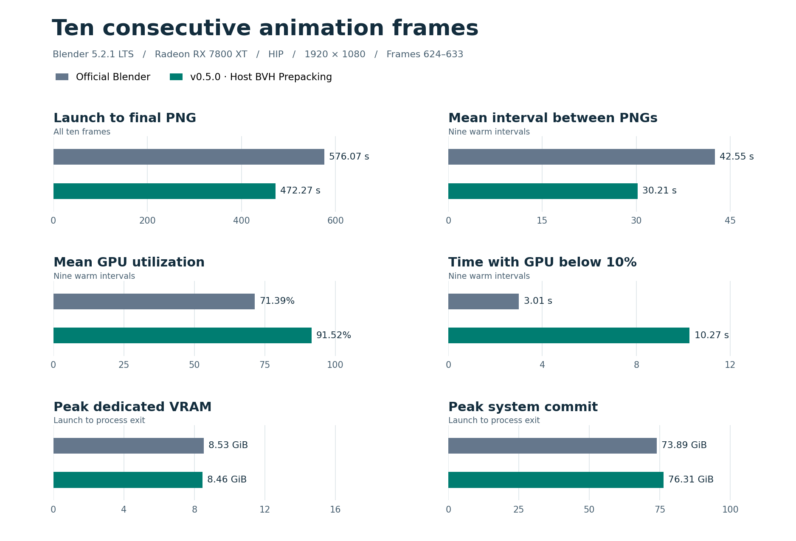

# Ruins benchmark · Host BVH Prepacking

English · [简体中文](README.zh-CN.md)

On a Radeon RX 7800 XT, the default v0.5.0 configuration rendered ten consecutive Ruins frames in **472.271 s**, from launch to the final PNG. Official Blender took **576.072 s**. The first PNG arrived **7.234 s later** with prepacking, then the mean interval between PNGs fell from **42.545 s to 30.208 s**.

## Ten measured frames and a 1,000-frame estimate

| Sequence | Official Blender | v0.5.0 default | Time saved | Reduction |
|---|---:|---:|---:|---:|
| 10 frames · measured | 576.072 s | 472.271 s | 103.801 s | **18.02%** |
| 1,000 frames · projected | 11 h 51 m 36 s | 8 h 26 m 18 s | 3 h 25 m 18 s | **28.85%** |


The estimate counts startup and the first PNG once. It adds 999 intervals at the average pace of the nine measured intervals. With both endpoint times in seconds from launch, `T₁₀₀₀ = T₁ + 999 × (T₁₀ − T₁) / 9`. This gives **42,695.952 s** for official Blender and **30,378.301 s** for v0.5.0. Both percentages use official Blender’s time at the same frame count as the denominator. The projected saving depends on later frames having similar geometry, sampling and output costs. [Projection inputs and results](data/projection.csv)

## Test conditions

| Setting | Value |
|---|---|
| Platform | Windows x64, Blender 5.2.1 LTS, upstream revision `9e2066aef7ef` |
| Hardware | One Radeon RX 7800 XT, 15.96 GiB dedicated VRAM and 31.95 GiB physical RAM visible to Windows |
| Scene | Ruins production animation, frames 624–633 in order, 1920 × 1080, 8-bit RGBA PNG |
| Cycles | HIP, software BVH2, persistent data, up to 256 adaptive samples with a 0.01 threshold |

Each configuration rendered the entire sequence once in a fresh process. Official Blender used the production worker's synchronous output. The v0.5.0 configuration used Host BVH Prepacking and a six-thread CPU output worker. The timed build was the prepacking release candidate. The final package adds checks for UV and motion pass changes and preserves the scene during a mid-animation switch to serial output. Ruins kept the same passes and preparation mode throughout.

## Timing, GPU and memory

| Measurement | Official Blender | v0.5.0 default |
|---|---:|---:|
| Launch to first PNG | 193.164 s | 200.398 s |
| Launch to final PNG | 576.072 s | 472.271 s |
| Launch to process exit | 591.002 s | 488.001 s |
| Mean interval between PNGs | 42.545 s | 30.208 s |
| Mean GPU utilization between first and final PNG | 71.39% | 91.52% |
| Time below 10% GPU utilization in that window | 3.007 s | 10.267 s |
| Peak dedicated VRAM | 8.53 GiB | 8.46 GiB |
| Peak physical RAM in use | 31.95 GiB | 31.95 GiB |
| Peak system commit | 73.89 GiB | 76.31 GiB |



The GPU activity sensor (AMD ADL) and dedicated VRAM counter (Windows WDDM) cover the entire card. Physical RAM and commit cover the entire system. Commit measures memory Windows has committed to back with RAM or the page file. Before launch, dedicated VRAM was **2.65 / 2.71 GiB** and system commit was **28.38 / 30.42 GiB**, in official/release order.

The monitor sampled approximately once per second. Mean GPU utilization and time below 10% weight each reading by its duration between publication of the first and final PNG. Memory peaks cover launch through process exit. The two vertical lines in each timeline mark the first and final PNG. [Telemetry samples](data/telemetry.csv) · [Run summaries](data/summary.csv)


## What happened at each handoff

At all **nine** handoffs Cycles evaluated the next frame and verified and packed its software BVH2 during the previous frame’s GPU sampling window. The CPU-side BVH package was ready **19.875–25.575 s** before the previous frame finished sampling. Once the previous frame released the device, the same Cycles session began the device update and consumed the prepared package exactly once. The gap from the last sampling batch of one frame to the first batch of the next ranged from **1.347 to 1.679 s** (median **1.472 s**). The per-frame CSV includes PNG timestamps for both runs and the release’s sampling, prepacking and handoff events, in seconds from launch. [Frame timings](data/frames.csv)

## Redrawing the charts

From the repository root, run the following commands. The Chinese charts require a supported Chinese font such as Microsoft YaHei or Noto Sans CJK SC. Use `--language en` to generate only the English edition.

```console
python -m pip install matplotlib
python benchmarks/plot.py
```

The Ruins production scene is private. The repository includes a [procedural integration fixture](../engine/lookahead/check_stock_pipeline.py) for exercising frame handoffs on a distributable scene.
