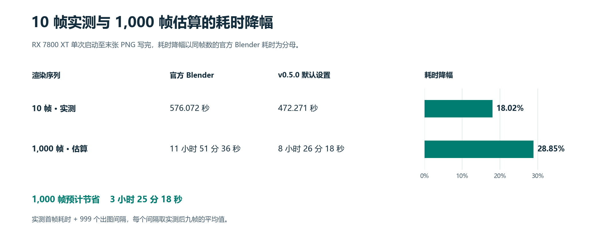
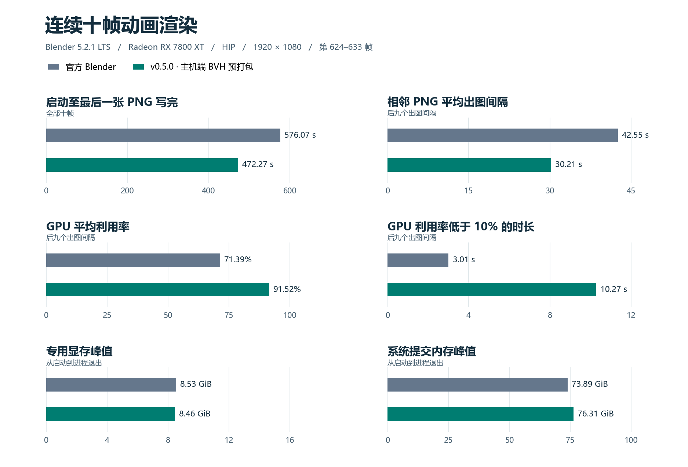
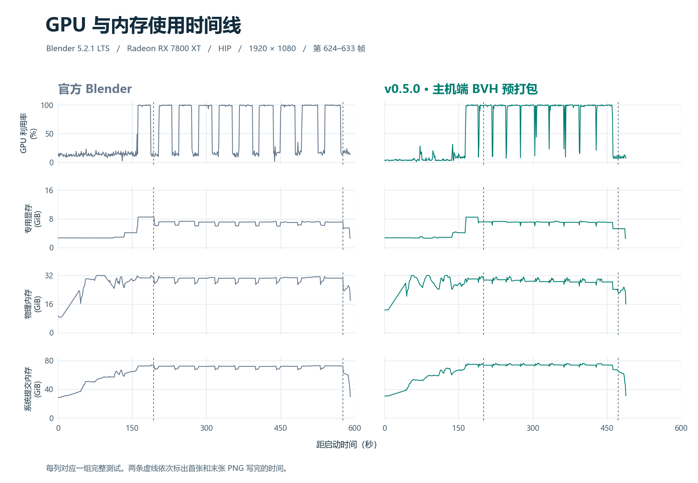

# Ruins 渲染基准 · 主机端 BVH 预打包

[English](README.md) · 简体中文

在一张 Radeon RX 7800 XT 上，从启动到 Ruins 连续十帧的最后一张 PNG 写完，v0.5.0 默认配置用时 **472.271 秒**，官方 Blender 用时 **576.072 秒**。预打包的首张 PNG **晚了 7.234 秒**，后续相邻两张 PNG 的平均出图间隔由 **42.545 秒缩短到 30.208 秒**。

## 十帧实测与千帧估算

| 帧数与来源 | 官方 Blender | v0.5.0 默认设置 | 节省时间 | 耗时降幅 |
|---|---:|---:|---:|---:|
| 10 帧 · 实测 | 576.072 秒 | 472.271 秒 | 103.801 秒 | **18.02%** |
| 1,000 帧 · 估算 | 11 小时 51 分 36 秒 | 8 小时 26 分 18 秒 | 3 小时 25 分 18 秒 | **28.85%** |



估算只计一次启动和首帧耗时，其余 999 帧按九个实测出图间隔的平均值计算。以启动为零点，`千帧耗时 = 首张 PNG 耗时 + 999 × (第十张 PNG 耗时 − 首张 PNG 耗时) / 9`。按毫秒级读数计算，官方 Blender 为 **42,695.952 秒**，v0.5.0 为 **30,378.301 秒**。两行降幅都以同帧数的官方 Blender 耗时为分母。实际千帧节省的时间取决于后续帧的几何、采样及输出开销。[估算输入与结果](data/projection.csv)

## 测试条件

| 项目 | 设置 |
|---|---|
| 平台 | Windows x64，Blender 5.2.1 LTS，上游修订 `9e2066aef7ef` |
| 硬件 | 单张 Radeon RX 7800 XT，系统可见专用显存 15.96 GiB、物理内存 31.95 GiB |
| 场景 | Ruins 生产动画，按原顺序连续渲染第 624–633 帧，1920 × 1080，8 位 RGBA PNG |
| Cycles | HIP、软件 BVH2、持久化数据，最多 256 个自适应采样，阈值 0.01 |

两组均在独立启动的进程中完整渲染一次。官方 Blender 使用生产脚本同步出图。v0.5.0 配置启用主机端 BVH 预打包，由六线程 CPU 后台进程处理输出。计时使用的是预打包候选引擎。正式发布包随后补充了通道变化检查和动画中途的串行回退处理。Ruins 的 UV 和运动通道设置固定，十帧持续使用预打包模式。

## 耗时、GPU 与内存

| 指标 | 官方 Blender | v0.5.0 默认设置 |
|---|---:|---:|
| 启动到首张 PNG 写完 | 193.164 秒 | 200.398 秒 |
| 启动到末张 PNG 写完 | 576.072 秒 | 472.271 秒 |
| 启动到进程退出 | 591.002 秒 | 488.001 秒 |
| 相邻 PNG 的平均出图间隔 | 42.545 秒 | 30.208 秒 |
| 首张到末张 PNG 之间的平均 GPU 利用率 | 71.39% | 91.52% |
| 同期 GPU 利用率低于 10% 的时长 | 3.007 秒 | 10.267 秒 |
| 专用显存峰值 | 8.53 GiB | 8.46 GiB |
| 整机物理内存使用峰值 | 31.95 GiB | 31.95 GiB |
| 系统提交内存峰值 | 73.89 GiB | 76.31 GiB |



AMD ADL 提供 GPU 活跃度读数，Windows WDDM 提供专用显存读数，两者均统计整张显卡。物理内存和系统提交统计整机。系统提交指 Windows 已承诺用物理内存或页面文件支持的内存。官方、发布版两次启动前的专用显存分别为 **2.65、2.71 GiB**，系统提交分别为 **28.38、30.42 GiB**。

监控约每秒采样一次。平均 GPU 利用率和低于 10% 的时长均取自首张到末张 PNG 写完之间，各读数按实际持续时间加权。内存峰值覆盖从启动到渲染进程退出的全过程。每列的两条虚线分别标出首张和末张 PNG 写完的时刻。[逐秒数据](data/telemetry.csv) · [两组结果汇总](data/summary.csv)



## 九次切帧时，CPU 和 GPU 分别在做什么

**九次切帧**中，Cycles 均在上一帧 GPU 采样期间完成了下一帧的场景求值、软件 BVH2 校验和打包。主机端 BVH 包比上一帧采样结束早 **19.875–25.575 秒**就绪。上一帧释放设备后，同一个 Cycles 会话开始更新设备，直接取用已准备好的 BVH 包，每个包消费一次。上一帧最后一批采样结束到下一帧首批采样开始之间，耗时 **1.347–1.679 秒**，中位数 **1.472 秒**。逐帧表包含两组各帧的 PNG 时间，以及发布版的采样、预打包和交接时间，均以渲染进程启动为零点。[逐帧时间记录](data/frames.csv)

## 重绘图表

在仓库根目录运行下列命令。中文图表需要微软雅黑、Noto Sans CJK SC 等支持的中文字体。添加 `--language en` 可仅生成英文版。

```console
python -m pip install matplotlib
python benchmarks/plot.py
```

Ruins 生产场景为私有素材。仓库包含可分发的程序化小场景，可用于验证切帧流程。[程序化集成测试](../engine/lookahead/check_stock_pipeline.py)
