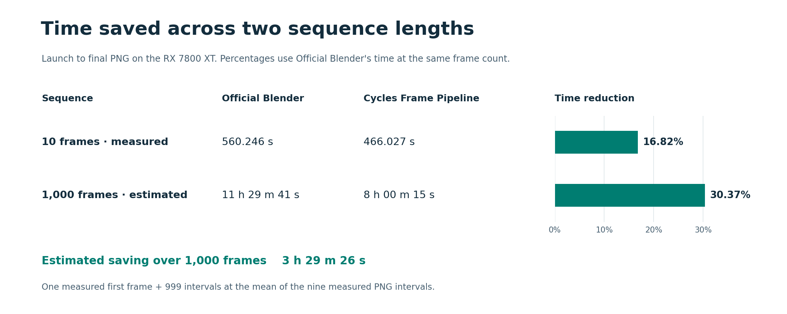

# Cycles Frame Pipeline v0.5.0 — Host BVH Prepacking

[简体中文发布说明](https://github.com/UnitTurn/cycles-frame-pipeline/blob/main/release/notes.zh-CN.md)

While the GPU samples one frame, Blender evaluates the next frame in animation order. For eligible HIP and CUDA scenes, Cycles validates and packs that frame’s software BVH2 on the CPU. Once the GPU releases the previous frame, Cycles uploads the prepared data and starts sampling. On the Ruins animation, all nine frame transitions used their prepared BVH exactly once. The median time between sampling frames was **1.47 seconds**.

## Performance on the Radeon RX 7800 XT

Three runs rendered Ruins frames 624–633 in order at 1920 × 1080 on one RX 7800 XT with HIP, persistent data, up to 256 adaptive samples and a 0.01 threshold. Each configuration ran once. Both modes use official Blender as the baseline at each frame count.

| Metric | Official Blender 5.2.1 LTS | Host BVH Prepacking (default) | Eager GPU Upload (optional) |
|---|---:|---:|---:|
| Launch to first PNG | 193.164 s | 200.398 s | 216.408 s |
| Launch to tenth PNG | 576.072 s | **472.271 s** | 476.824 s |
| Measured reduction for ten frames | Baseline | **18.02%** | 17.23% |
| Mean interval between PNGs after the first | 42.545 s | 30.208 s | 28.935 s |
| Mean whole-GPU utilization over those nine intervals | 71.39% | 91.52% | 94.86% |
| Peak dedicated GPU memory, whole card | 8.53 GiB | 8.46 GiB | 12.40 GiB |
| Peak Windows committed memory, whole system | 73.89 GiB | 76.31 GiB | 87.49 GiB |
| Projected time to the 1,000th PNG | 11 h 51 min 36 s | **8 h 26 min 18 s** | 8 h 05 min 23 s |
| Projected reduction for 1,000 frames | Baseline | **28.85%** | 31.79% |

The projection counts launch to the first PNG once, then uses each run’s mean of the nine measured intervals for the remaining 999 frames. The default mode was timed on the prepacking release candidate. Eager upload uses the earlier run with the same settings. The packaged engine also checks for changes to UV and motion passes and handles a switch to serial output. Ruins kept the same passes and preparation mode throughout. [Benchmark report, frame timings and GPU and memory traces](https://github.com/UnitTurn/cycles-frame-pipeline/blob/9071b69024e589cd39025e2c9da8515bbaacb8d9/benchmarks/README.md)

### Historical image comparison · v0.4.0 Eager GPU Upload vs official Blender

The pixel comparison decodes each prepared PNG and compares it with the official PNG for the same frame. Of 20,736,000 pixels, **5,343** differed in RGB, with a maximum absolute difference of **1/255** in every frame. All alpha values matched. The mean absolute difference over RGB channels was **0.00008644** on the 0–255 scale. [Historical benchmark](https://github.com/UnitTurn/cycles-frame-pipeline/blob/v0.4.0/benchmarks/README.md)

## Installation and use

Install official Blender **5.2.1 LTS for Windows x64**, build `9e2066aef7ef`. Select the extension and Windows engine overlay in the same language. The overlay installer uses the runtime and GPU kernels from that Blender installation. [Installation guide](https://github.com/UnitTurn/cycles-frame-pipeline/blob/v0.5.0/README.md#install)

| Package | English | 简体中文 |
|---|---|---|
| Blender extension | [English ZIP](https://github.com/UnitTurn/cycles-frame-pipeline/releases/download/v0.5.0/cycles_frame_pipeline-0.5.0-en.zip) | [中文 ZIP](https://github.com/UnitTurn/cycles-frame-pipeline/releases/download/v0.5.0/cycles_frame_pipeline-0.5.0-zh-CN.zip) |
| Windows x64 engine overlay | [English ZIP](https://github.com/UnitTurn/cycles-frame-pipeline/releases/download/v0.5.0/cycles-frame-pipeline-windows-x64-0.5.0-en.zip) | [中文 ZIP](https://github.com/UnitTurn/cycles-frame-pipeline/releases/download/v0.5.0/cycles-frame-pipeline-windows-x64-0.5.0-zh-CN.zip) |

The native command-line mode uses host BVH prepacking by default on eligible scenes. Add `--eager-upload` to prepare the next frame in a second GPU session. In the panel, clear **Host BVH Prepacking** to select early upload. [Render instructions](https://github.com/UnitTurn/cycles-frame-pipeline/blob/v0.5.0/README.md#render-an-animation) · [Project source ZIP](https://github.com/UnitTurn/cycles-frame-pipeline/releases/download/v0.5.0/cycles_frame_pipeline-source-0.5.0.zip)

## GPU coverage

The AMD production benchmark above covers HIP with software BVH2. CUDA also supports the new software BVH2 path in the engine. OptiX uses NVIDIA’s native acceleration structures and builds them through the selected GPU session. Earlier RTX 3090 tests completed a three-frame animation on both CUDA and OptiX. Production timings for v0.5.0 on NVIDIA remain unmeasured. [GPU and Blender compatibility](https://github.com/UnitTurn/cycles-frame-pipeline/blob/v0.5.0/README.md#gpu-and-blender-compatibility)
