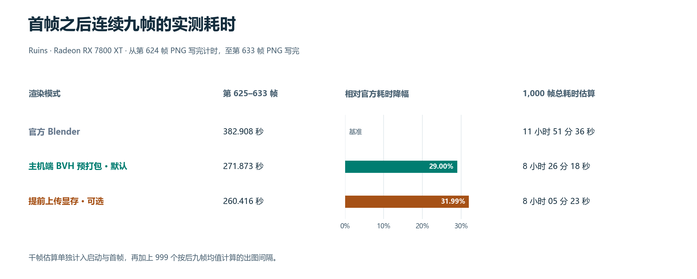

# Cycles 帧间流水线 v0.5.0 — 主机端 BVH 预打包

[English release notes](https://github.com/UnitTurn/cycles-frame-pipeline/releases/tag/v0.5.0)

GPU 为当前帧采样时，Blender 按动画顺序求值下一帧。在符合条件的 HIP 和 CUDA 场景中，Cycles 提前在 CPU 上校验并打包下一帧用于光线追踪的软件 BVH2。前一帧释放 GPU 后，Cycles 直接上传打包结果并开始采样。Ruins 动画的九次切帧均直接使用了各自预先打好的 BVH，每份使用一次。前帧结束采样到后帧开始采样的中位间隔为 **1.47 秒**。

## Radeon RX 7800 XT 实测

Ruins 第 624–633 帧在单张 RX 7800 XT 上以 HIP 连续渲染。三组均使用 1920 × 1080、持久化数据、最多 256 个自适应采样和 0.01 阈值，各完整运行一次。两种模式的耗时降幅均以同帧数的官方 Blender 为基准。

| 指标 | 官方 Blender 5.2.1 LTS | 主机端 BVH 预打包（默认） | 提前上传（可选） |
|---|---:|---:|---:|
| 启动到首张 PNG 写完 | 193.164 秒 | 200.398 秒 | 216.408 秒 |
| 启动到第十张 PNG 写完 | 576.072 秒 | **472.271 秒** | 476.824 秒 |
| 十帧实测耗时降幅 | 基准 | **18.02%** | 17.23% |
| 后九个出图间隔均值 | 42.545 秒 | 30.208 秒 | 28.935 秒 |
| 上述九个间隔的整卡平均 GPU 利用率 | 71.39% | 91.52% | 94.86% |
| 整卡专用显存峰值 | 8.53 GiB | 8.46 GiB | 12.40 GiB |
| Windows 整机提交内存峰值 | 73.89 GiB | 76.31 GiB | 87.49 GiB |
| 1,000 帧预计耗时 | 11 小时 51 分 36 秒 | **8 小时 26 分 18 秒** | 8 小时 05 分 23 秒 |
| 1,000 帧预计耗时降幅 | 基准 | **28.85%** | 31.79% |

千帧估算计入一次启动到首张 PNG 的实测耗时，其余 999 帧沿用各自后九个出图间隔的均值。默认模式计时取自预打包候选引擎，提前上传沿用相同设置的历史实测。正式包增加了通道变化检查和串行回退处理，Ruins 十帧的通道和准备模式保持固定。 [完整基准、逐帧记录与 GPU／内存曲线](https://github.com/UnitTurn/cycles-frame-pipeline/blob/9071b69024e589cd39025e2c9da8515bbaacb8d9/benchmarks/README.zh-CN.md)

### 历史画面对照 · v0.4.0 提前上传与官方 Blender

逐帧解码正式帧交接与官方的同帧 PNG。20,736,000 个像素中有 **5,343 个**的 RGB 存在差异，每一帧的最大通道差均为 **1/255**。全部 alpha 一致，按 0–255 计的 RGB 通道平均绝对差为 **0.00008644**。 [历史基准](https://github.com/UnitTurn/cycles-frame-pipeline/blob/v0.4.0/benchmarks/README.zh-CN.md)

## 安装与使用

安装官方 **Blender 5.2.1 LTS Windows x64**，构建提交号为 `9e2066aef7ef`。选择同一语言的 Blender 扩展和 Windows 引擎覆盖包。覆盖包中的安装脚本会从该版本的官方 Blender 获取运行库和 GPU 内核。[安装指南](https://github.com/UnitTurn/cycles-frame-pipeline/blob/v0.5.0/README.zh-CN.md#安装)

| 下载项 | 简体中文 | English |
|---|---|---|
| Blender 扩展 | [中文 ZIP](https://github.com/UnitTurn/cycles-frame-pipeline/releases/download/v0.5.0/cycles_frame_pipeline-0.5.0-zh-CN.zip) | [English ZIP](https://github.com/UnitTurn/cycles-frame-pipeline/releases/download/v0.5.0/cycles_frame_pipeline-0.5.0-en.zip) |
| Windows x64 引擎覆盖包 | [中文 ZIP](https://github.com/UnitTurn/cycles-frame-pipeline/releases/download/v0.5.0/cycles-frame-pipeline-windows-x64-0.5.0-zh-CN.zip) | [English ZIP](https://github.com/UnitTurn/cycles-frame-pipeline/releases/download/v0.5.0/cycles-frame-pipeline-windows-x64-0.5.0-en.zip) |

命令行原生模式默认在符合条件的场景中启用主机端 BVH 预打包。加上 `--eager-upload` 可使用第二个 GPU 会话，提前上传下一帧。在面板中取消勾选「主机端 BVH 预打包」也可切换到提前上传。[渲染方法](https://github.com/UnitTurn/cycles-frame-pipeline/blob/v0.5.0/README.zh-CN.md#渲染动画) · [项目源码 ZIP](https://github.com/UnitTurn/cycles-frame-pipeline/releases/download/v0.5.0/cycles_frame_pipeline-source-0.5.0.zip)

## 显卡支持范围

上表为 AMD HIP 与软件 BVH2 在生产工程上的实测。引擎的 CUDA 后端也支持此次新增的软件 BVH2 预打包。OptiX 使用 NVIDIA 原生加速结构，由所选 GPU 会话构建。此前已在 RTX 3090 上分别用 CUDA 和 OptiX 跑通连续三帧动画。v0.5.0 在 NVIDIA 上的生产工程耗时仍待实测。[显卡与 Blender 兼容范围](https://github.com/UnitTurn/cycles-frame-pipeline/blob/v0.5.0/README.zh-CN.md#显卡与-blender-兼容范围)
